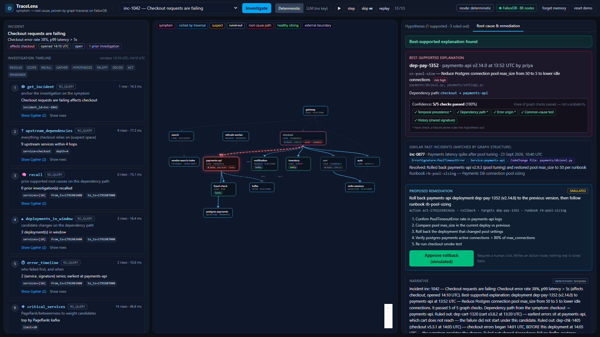

# TraceLens

**Symptom → root cause, proven by graph traversal on FalkorDB.**

> *TraceLens doesn't just tell you what's broken — it walks the graph to prove why, shows you the suspects it ruled out, and remembers the answer next time.*

Built for **Graph Hacks: Context for AI Agents** (WeMakeDevs × FalkorDB), 17–18 Oct 2026.

**Tracks entered:** **Track 01 – Agents That Act on Connected Data** (primary) · **Track 02 – Agent Memory and Coordination** (Scenario B below).

**Demo video:** _link goes here_ · **Live demo:** _local setup below (live deployment optional)_

---

## The problem

When checkout breaks at 14:10, everyone looks at the deploy to checkout at 14:05. It is usually the wrong suspect. The real cause is often two hops upstream — a config change on a dependency whose errors began *before* the obvious deploy. Finding that takes an engineer twenty minutes of log-diving and tribal memory ("didn't we see this pool error three weeks ago?").

## What TraceLens does

| Reference demo ("Blast Radius") | TraceLens |
|---|---|
| Walks *downstream* impact | Walks *upstream* cause — from symptom to root cause |
| Returns facts | Generates **competing hypotheses and falsifies them** with graph checks |
| Lists recent changes | **Rejects the obvious suspect** with timestamped, traversable evidence |
| — | Finds past incidents by **shared graph structure** (same `ErrorSignature` / `Service` / `CodeChange` file), not text similarity |
| Saves findings | **Learns**: confirmed root causes are written back to the graph and shorten the next investigation |
| — | **Acts**: proposes a rollback tied to a specific `Deployment` + `Runbook`, executed (simulated) only after a human click |

Every conclusion comes from a Cypher query or a graph algorithm. The agent never writes Cypher. Remove FalkorDB and nothing works.



## 30-second quick start

```bash
git clone <this repo> && cd tracelens
docker compose up --build          # FalkorDB (6379, Browser on 3000) + TraceLens (8000)
# open http://localhost:8000  →  pick "inc-1042 — Checkout requests are failing"  →  Investigate
```

The app seeds the demo graph automatically when it is empty. No API key is needed (deterministic mode).

### Dev setup (hot reload)

```bash
docker compose up -d falkordb
python -m venv .venv && .venv/Scripts/activate      # or source .venv/bin/activate
pip install -r requirements.txt
python -m backend.seed                               # reset + seed the demo graph
uvicorn backend.api.main:app --reload --port 8000
cd frontend && npm install && npm run dev            # http://localhost:5173 (proxies /api)
```

### Tests (against a real FalkorDB container, separate graph key `tracelens_test`)

```bash
PYTHONIOENCODING=utf-8 python -m pytest -q           # 27 tests: one per tool, scenario ground truth, validator, unknown-entity guards
```

## The three scenarios

| | Incident | What the agent must do | Outcome |
|---|---|---|---|
| **A** | `inc-1042` Checkout requests are failing | Reject the checkout deploy (errors began 14:01, deploy 14:05), reject the cart deploy (earliest errors sit at payments-api, which cart never reaches), support the payments-api deploy that cut the DB pool 50 → 5, exonerate the shared database via a healthy sibling, match incident `inc-0877` through a shared `ErrorSignature`, propose rollback + runbook | `root_cause_supported`, 5/5 checks, 11 tool calls |
| **B** | `inc-1043` Refunds failing (run after A) | `recall` the Investigation A wrote back, re-verify the timeline for refunds-worker, answer with "learned <date>" | `answered_from_memory`, 5 tool calls |
| **C** | `inc-1044` Search results are empty | No deployments in window; the path leaves the modeled graph at an external vendor. Say so, list what was checked and what data would resolve it | `inconclusive` |
| — | `inc-9999` / `warehouse-robot` | Name does not resolve → stop | `unknown_entity`, **0 tool calls** |

Ground truth lives only in `tests/scenarios.yaml`; the agent reaches it through queries.

## Graph data model

```
(:Service {name, tier, team, external})-[:DEPENDS_ON {kind: 'sync'|'async', weight: 1|2}]->(:Service)
(:Deployment {id, at, version, author})-[:DEPLOYED_TO]->(:Service)
(:Deployment)-[:INCLUDES]->(:CodeChange {id, summary, files, risk})
(:ErrorEvent {id, at, message, count})-[:EMITTED_BY]->(:Service)
(:ErrorEvent)-[:HAS_SIGNATURE]->(:ErrorSignature {key})          // shared node → similarity by traversal
(:Incident {id, title, status, opened_at, symptom})-[:AFFECTS]->(:Service)
(:Incident)-[:OBSERVED]->(:ErrorEvent)
(:Incident)-[:RESOLVED_BY]->(:Resolution {id, summary, at})-[:FOLLOWED]->(:Runbook {id, title, steps})
(:Resolution)-[:REVERTED]->(:Deployment)
(:Runbook)-[:APPLIES_TO]->(:Service)

// written by the agent itself (memory + audit trail)
(:Investigation {id, at, mode, outcome, tool_calls, confidence})-[:INVESTIGATED]->(:Incident)
(:Investigation)-[:CONSIDERED]->(:Hypothesis {id, status, score, kind, label, confirmed})
(:Hypothesis)-[:SUSPECTS]->(:Deployment|:CodeChange|:Service)
(:Hypothesis)-[:SUPPORTED_BY|REJECTED_BY {check}]->(:ErrorEvent|:Deployment|:Incident|:Service)
(:Investigation)-[:PROPOSED]->(:Action {id, kind, status, simulated})-[:TARGETS]->(:Deployment)
(:Action)-[:FOLLOWS]->(:Runbook)
```

Timestamps are integer epoch seconds. `weight` (sync 1 / async 2) is what `algo.SPpaths` minimizes. Full detail, topology and timeline: [`docs/GRAPH_MODEL.md`](docs/GRAPH_MODEL.md).

## Architecture

```
React + React Flow  ──/api──►  FastAPI  ──►  Investigator (bounded state machine)  ──►  Tool catalog (11 tools, fixed Cypher)  ──►  FalkorDB
                                                RESOLVE→SCOPE→RECALL→GATHER→HYPOTHESIZE→FALSIFY→DECIDE→ACT→REMEMBER
```

- **Backend:** Python 3.11+, FastAPI, official `falkordb` client. **No LangGraph** — the state machine is one readable file.
- **Tool catalog** (`backend/tools/catalog.py`): typed, validated arguments; every service/incident name resolved against the graph before any query; reads via `GRAPH.RO_QUERY`; every call traced (tool, args, exact Cypher, params, ms, rows). [`docs/QUERIES.md`](docs/QUERIES.md) is generated from it.
- **Algorithms:** `algo.SPpaths` (weighted path check), `algo.pageRank` + `algo.betweenness` (criticality weighting).
- **Frontend:** Vite + React + TypeScript + Tailwind, React Flow + dagre; the traversal animates step by step; "Show Cypher" on every step.
- **MCP server** (`backend/mcp_server.py`): exposes the same catalog (not raw Cypher) over stdio; `python -m backend.mcp_client_demo` drives Scenario A through it.

More: [`docs/ARCHITECTURE.md`](docs/ARCHITECTURE.md).

## Agent workflow and scoring

Per candidate deployment: **temporal precedence** (hard), **dependency path** via SPpaths (hard), **error origin** (hard), **common cause** via healthy siblings (soft), **history** via shared ErrorSignature (soft). Any hard failure → *ruled out*. Score = passed / evaluated. Exactly one supported → `root_cause_supported`.

**Confidence means "share of checks passed" — not a probability.** We never say "proven cause"; we say *best-supported explanation* and label items *supported / ruled out / inconclusive*. Rejected hypotheses are kept, with the evidence that rejected them.

## Deterministic vs LLM mode

- **Deterministic (default, what the demo and tests use):** no key needed. Narrative is a template built from the returned rows.
- **LLM (optional toggle):** any OpenAI-compatible endpoint, free tier only (Groq `openai/gpt-oss-120b` by default, with Gemini `gemini-3.8-flash` as an automatic fallback provider; Ollama works too, see `.env.example`). The LLM only writes the narrative. Order on failure: primary provider → fallback provider → deterministic template, every hop shown in the UI. A validator rejects any narrative naming an entity not in the evidence, saying "proven", or claiming impact when traversals were empty; on rejection, timeout, 429 or missing key it falls back to the template and the UI shows "LLM unavailable → deterministic". The LLM never writes Cypher.

## API

`GET /api/health` · `GET /api/incidents` · `GET /api/graph` · `POST /api/investigations {incident_id | service, mode}` · `GET /api/investigations[/{id}]` · `POST /api/actions/{id}/approve` (simulated) · `POST /api/demo/reset[?memory_only=true]` · `GET /api/tools`

## Limitations (honest list)

- Demo data is synthetic and deterministic (14 services); there is no real log/deploy ingestion.
- The remediation is **simulated**: an `Action` node is written, nothing is rolled back.
- The investigation window is a fixed 60 minutes before `opened_at`.
- LLM mode writes the narrative only; tool selection is fixed by the state machine.
- Full reports (with traces) are held in process memory; the durable record is the graph.
- FalkorDB does not accept a parameter as a variable-length hop bound, so the depth is validated (1..4) and inlined.

## AI-assistance disclosure

This project was built during the event with **Claude Code (Anthropic, model Claude Fable 5.1)** as a pair programmer. The AI wrote most of the first drafts of the code, queries, tests and docs under the author's direction; the author defined the product, the graph model, the scenarios and the check/scoring rules, reviewed every query against FalkorDB, ran the tests and the demo, and can explain every design decision (see [`docs/EXPLAIN_IT.md`](docs/EXPLAIN_IT.md)). No code was copied from prior projects. FalkorDB behaviour (algorithm signatures, parameter limits) was verified empirically against v4.22.1 during the build.

## Repository map

```
backend/            db.py · seed.py · config.py · tools/ (catalog) · agent/ (engine, narrative, llm) · api/ · mcp_server.py
frontend/           Vite + React + TS dashboard
tests/              scenarios.yaml (ground truth) · test_tools.py · test_scenarios.py · test_validator.py
docs/               GRAPH_MODEL · ARCHITECTURE · QUERIES (generated) · DEMO_SCRIPT · EXPLAIN_IT · BLOG_DRAFT
docker-compose.yml  FalkorDB (pinned digest) + app · Dockerfile (multi-stage)
```
